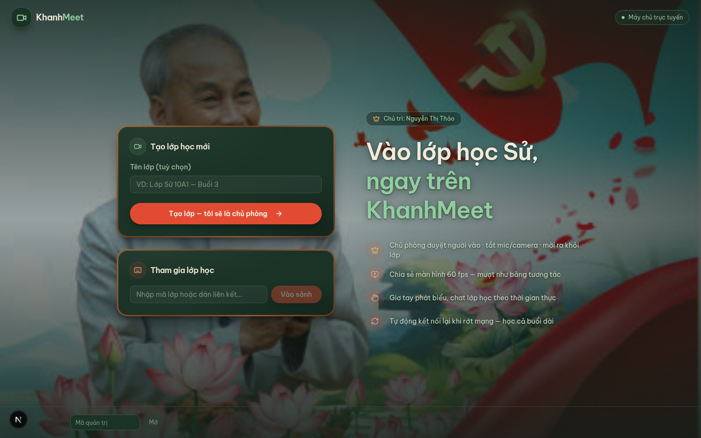
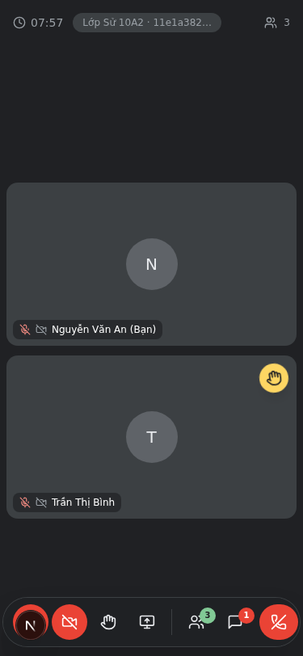

# 🎓 KhanhMeet — Lớp học trực tuyến

<div align="center">
  
</div>

<br />

**KhanhMeet** là ứng dụng lớp học / họp trực tuyến viết riêng cho việc dạy học: chủ phòng duyệt từng người vào lớp, tắt mic/camera từ xa, giơ tay phát biểu, chat thời gian thực, chia sẻ màn hình 60 fps — tất cả chạy trực tiếp giữa các trình duyệt bằng **WebRTC**.

<div align="center">
  
</div>

## ✨ Tính năng

- 🚪 **Chủ phòng duyệt người vào** — ai cũng phải được duyệt mới vào được lớp
- 🎥 **WebRTC thuần** — video/audio/chia sẻ màn hình 60 fps chạy P2P, tự động xuyên NAT nhờ STUN/TURN
- ✋ **Giơ tay phát biểu + chat real-time** — tin nhắn lưu tối đa 200 tin gần nhất mỗi lớp
- 🔇 **Điều khiển từ xa 3 chế độ** — chủ phòng tắt/bật/khoá mic & camera của từng thành viên
- 🔌 **Tự động kết nối lại** — rớt mạng, refresh trang đều tự vào lại lớp
- 🛡️ **Bảng điều khiển chủ web** — quan sát mọi lớp học đang diễn ra (CCTV), nhật ký hoạt động, ghi chú từng học sinh
- 📱 **Chạy tốt trên điện thoại** — cảnh báo khi mở bằng trình duyệt nhúng (Zalo/Facebook) chặn camera

## 🏗️ Kiến trúc

```
┌─────────────────────┐        WSS/HTTPS        ┌──────────────────────────┐
│   WEB (Next.js 16)  │ ◄──────────────────────► │  SIGNALING (Bun service) │
│  Vercel / máy chủ   │                          │  Railway / Render / Fly  │
│                     │                          │                          │
│  • Trang chủ, sảnh   │   • REST /api/*         │  • Socket.IO (WebRTC     │
│    chờ, lớp học     │   • WebSocket /socket.io │    signaling, chat,      │
│  • React + Tailwind │                          │    duyệt vào, điều khiển)│
│    + shadcn/ui      │      WebRTC P2P          │  • Prisma + SQLite       │
│                     │    (video/audio chạy    │    (phòng, nhật ký,      │
│                     │     thẳng giữa các      │    ghi chú)              │
│                     │     trình duyệt)        │                          │
└─────────────────────┘                          └──────────────────────────┘
```

Video/audio **không đi qua máy chủ** — signaling chỉ trao đổi kết nối ban đầu, sau đó WebRTC chạy P2P trực tiếp (có TURN dự phòng khi hai mạng "không nhìn thấy nhau").

## 📁 Cấu trúc thư mục

```
├── src/                        # Ứng dụng Next.js (App Router)
│   ├── app/                    #   Trang chủ + API trung chuyển (chế độ local)
│   ├── components/meet/        #   Màn hình: trang chủ, sảnh chờ, lớp học,
│   │                           #   bảng điều khiển chủ web, chat, ô video…
│   └── lib/meet/               #   Logic WebRTC, signaling, ICE (STUN/TURN)
├── mini-services/signaling/    # Dịch vụ signaling (Bun + Socket.IO + Express
│                               # + Prisma/SQLite) — deploy riêng khi chạy thật
├── public/                     # Ảnh tĩnh (logo, ảnh nền)
└── docs/                       # Ảnh chụp màn hình cho README
```

## 🖥️ Chạy local (một máy)

**Yêu cầu:** [Bun](https://bun.sh) ≥ 1.0

```bash
# 1. Dịch vụ signaling (cổng 3003 + 3004)
cd mini-services/signaling
bun install
cp .env.example .env        # sửa OWNER_CODES thành mã bí mật của bạn
bun run db:push             # tạo SQLite lần đầu
bun run dev

# 2. Web (cổng 3000) — mở terminal thứ hai
cd ../..
bun install
bun run dev
```

Mở `http://localhost:3000`. Ở chế độ local, web tự trung chuyển mọi kết nối tới signaling — không cần cấu hình gì thêm.

## 🚀 Deploy lên Internet (Vercel + Railway)

Web và signaling là **hai dịch vụ tách rời** — triển khai lần lượt:

### Bước 1 — Deploy dịch vụ signaling lên Railway

1. Vào [railway.app](https://railway.app) → **New Project** → **Deploy from GitHub repo** → chọn repo này.
2. **Settings → Root Directory**: `mini-services/signaling`.
3. **Variables** — thêm:
   | Biến | Giá trị | Ghi chú |
   |---|---|---|
   | `OWNER_CODES` | `MÃ-BÍ-MẬT-CỦA-BẠN` | ⚠ Bắt buộc! Mã mở bảng điều khiển chủ web |
4. **Settings → Networking → Generate Domain** — được URL dạng `https://…up.railway.app`.
5. Kiểm tra: mở `https://<url>/api/health` phải trả `{"ok":true,…}`.

> Railway tự cấp biến `PORT` — dịch vụ tự gộp REST + Socket.IO vào một cổng, không cần làm gì thêm. SQLite bị xoá mỗi lần deploy lại; muốn giữ lịch sử thì gắn **Volume** vào thư mục `db`.
>
> Tương tự có thể dùng Render/Fly.io (Bun hoặc Docker) — chỉ cần đặt `OWNER_CODES` và expose cổng `PORT`.

### Bước 2 — Deploy web lên Vercel

1. Vào [vercel.com](https://vercel.com) → **Add New Project** → import repo này (Root Directory để mặc định).
2. **Environment Variables** — thêm cho môi trường Production + Preview:
   | Biến | Giá trị |
   |---|---|
   | `NEXT_PUBLIC_SIGNALING_URL` | `https://…up.railway.app` (URL từ Bước 1) |
3. **Deploy** — xong! Chia sẻ liên kết lớp học cho học sinh.

> ⚠️ `NEXT_PUBLIC_*` được nhúng vào code **lúc build** — nếu đổi giá trị phải **Redeploy** mới có hiệu lực.

## 🔐 Bảo mật — ba cấp quyền

| Vai trò | Cách có được | Quyền |
|---|---|---|
| **Thành viên** | Nhận liên kết lớp | Vào lớp sau khi được duyệt, giơ tay, chat |
| **Chủ phòng** | Tạo lớp (máy tự giữ `hostKey`) | Duyệt/từ chối/đuổi người, điều khiển mic/camera |
| **Chủ web** | Nhập `OWNER_CODES` (ô nhỏ góc trái dưới) | Xem mọi lớp, cảnh báo, tan lớp, ghi chú |

- `hostKey` chỉ nằm trên máy người tạo lớp (localStorage) — không ai giả danh được chủ phòng.
- `OWNER_CODES` chỉ nằm trong biến môi trường của dịch vụ signaling — **không bao giờ commit vào repo**.
- Camera/mic là **minh bạch**: tắt là tắt thật (track.enabled = false), không có luồng ngầm.

## 🛠️ Công nghệ

[Next.js 16](https://nextjs.org) · [React 19](https://react.dev) · [TypeScript](https://typescriptlang.org) · [Tailwind CSS 4](https://tailwindcss.com) · [shadcn/ui](https://ui.shadcn.com) · [Socket.IO](https://socket.io) · [WebRTC](https://webrtc.org) · [Prisma](https://prisma.io) + SQLite · [Bun](https://bun.sh) · Font [Be Vietnam Pro](https://fonts.google.com/specimen/Be+Vietnam+Pro)

## 📄 Giấy phép & ghi công

Mã nguồn mở cho mục đích học tập. Ảnh nền áp phích Bác Hồ: tác giả **Anhpng.com**.
